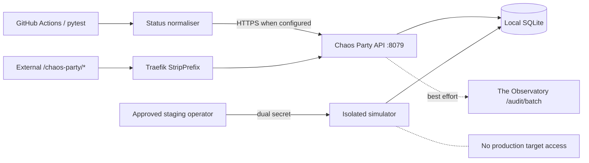

# The Chaos Party — implementation and safety contract

**Product ID:** PID-TCP · **Lead AIs:** The Mad Hatter (adversarial) and Alice Dream (deterministic QA)
**Repository:** Trancendos/Tranc3 · **Worker:** `workers/chaos-party/` · **Internal port:** 8079

## Implemented interfaces

- `POST /runs/batch` accepts canonical statuses `pass/fail/skip/error`. Invalid batches are rejected before any row is persisted.
- `GET /stats` and `GET /health` exclude skipped runs from the pass-rate denominator. They still include skipped runs in total-run counts.
- `scripts/report_tests_to_chaos_party.py` maps pytest outcomes to canonical statuses, preserves the original outcome in metadata, and fails when a configured endpoint rejects a batch.
- `observatory_bridge.py` is packaged in the worker image. Forwarding remains **best-effort**; delivery is not durable when the Observatory is down.
- The external Traefik route `/chaos-party/*` uses `chaos-party-strip` to dispatch to the worker's unprefixed API.

## Deployment and data flow



The `CHAOS_PARTY_URL` and `INTERNAL_SECRET` GitHub Actions secrets are needed for hosted CI forwarding. A GitHub-hosted runner **cannot** reach a Compose-only internal DNS name. Do not expose the worker directly to the public Internet merely to make CI forwarding work. Use an authenticated, network-reachable ingest gateway or a private self-hosted runner; verify the network path and credential storage separately.

### Worker environment

| Variable | Default | Meaning |
|---|---|---|
| `INTERNAL_SECRET` | **required** | Strong unique internal API secret |
| `PORT` | 8079 | Worker and Compose use the same canonical port |
| `OBSERVATORY_FORWARD_ENABLED` | true | Best-effort forwarding |
| `AUDIT_SERVICE_URL` | http://audit-service:8025 | Internal Observatory audit endpoint |
| `CHAOS_ENVIRONMENT` | unset | Must equal `staging` to enable isolated simulations |
| `CHAOS_EXECUTION_ENABLED` | false | Must equal `true` to enable isolated simulations |
| `CHAOS_APPROVAL_TOKEN` | unset | Independent approval credential (16+ characters; different from INTERNAL_SECRET) |

### Staging-only isolated simulation

`PATCH /chaos/{experiment_id}/run` no longer marks an experiment `running` without performing work. Instead, it fails closed unless all of the following are true:

1. Caller has the valid `X-Internal-Secret`.
2. `CHAOS_ENVIRONMENT=staging` and `CHAOS_EXECUTION_ENABLED=true`.
3. Caller supplies a valid independent `X-Chaos-Approval` matching `CHAOS_APPROVAL_TOKEN`.
4. The experiment target is **exactly** `local-sandbox`.
5. The experiment type is `latency_injection` (local async sleep, 0–500 ms) or `error_injection` (synthetic HTTP 500 evidence only).
6. The configured TTL is an integer 1–10 seconds, and all parameters are allowlisted.

The worker atomically claims an idle experiment, runs the bounded in-process simulation, then records `completed` or `failed` with results and `ended_at`. A replay returns HTTP 409. No network request is made to any target and no external state needs rollback. High-risk types (memory pressure, CPU spikes, connection drops, data corruption) are **not executable**. These capabilities are intentionally blocked until an independently reviewed staging fault-injection design exists.

Example local staging configuration (replace placeholders with independently generated secrets):

```sh
export INTERNAL_SECRET="<unique internal secret>"
export CHAOS_ENVIRONMENT=staging
export CHAOS_EXECUTION_ENABLED=true
export CHAOS_APPROVAL_TOKEN="<different approval secret>"
```

The normal production Compose configuration does not set the staging flags or approval token, so experiment execution remains disabled.

## Verification

`Chaos Party Contract` workflow runs on pull requests changing this component and tests:
- The reporter/worker status contract and batch atomicity.
- Isolated staging simulation safety and lifecycle.
- Docker image build with the real shared-core context.
- Live container health, authenticated `/runs/batch`, and skip-aware `/stats`.

The main `Test Suite` workflow no longer ignores dependency installation or pytest errors. The root OpenTelemetry API pin is aligned with the SDK pin to address the previously observed pip resolver failure.

## Remaining release blockers

- **Network path:** GitHub-hosted CI → worker is not verified. No automatic forwarding occurs when `CHAOS_PARTY_URL` is unset.
- **Durability:** Observatory delivery is best-effort; a durable outbox and retry worker are needed for lossless audit trails.
- **Deployment:** Actual Traefik, worker startup and Observatory connectivity in production must be measured.
- **Generated docs and CI:** All repository checks must be green before merging; never merge a draft PR merely because a subset of checks passed.
- **Drive security:** The Chaos Party folder was previously reported with an `anyone` writer permission. Confirm and correct via an authorised Drive admin workflow.
- **Live chaos:** No fault injection into actual platform services has been implemented or authorised. The available executor is a safe local simulation only.

## Operator release checklist

1. Review code and new tests in the pull request.
2. Confirm all mandatory CI checks and container smoke tests pass.
3. Set production `INTERNAL_SECRET` via the secret manager; never commit it.
4. Keep `CHAOS_EXECUTION_ENABLED` unset or false in production.
5. Test external `/chaos-party/health` routing and internal `/health`.
6. Send a synthetic test batch, verify SQLite row count, then verify its Observatory audit entry.
7. Confirm restore from a volume backup before claiming durable evidence.
8. Review generated solution-pack and CMDB documentation against actual source.
